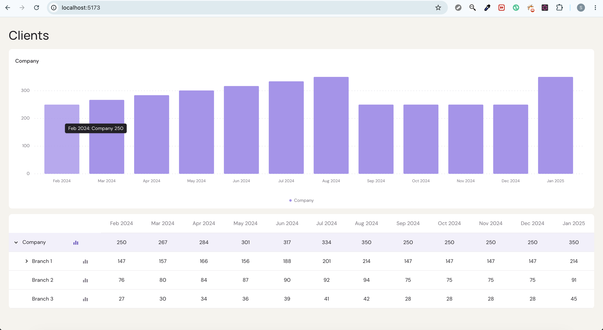

# Nevis Client Dashboard

A React dashboard for exploring client development from Company to Branch, Advisor, and acquisition Channel. It includes a D3 stacked bar chart and an accessible expandable detail table.

## Screenshots

### Default view: company totals



On load, the chart shows the Company's supplied monthly totals, and the Company row is highlighted as the row being charted. This view isn't stacked like the Figma design: the data only has an acquisition-channel breakdown for one advisor, so I didn't infer a company-level split (see [Chart breakdown](#chart-breakdown-a-deliberate-change-from-the-design)). Hovering a bar shows its month and value.

### Drilling down to an advisor's acquisition channels


Two separate controls in each row:

- **Expand/collapse:** the chevron, or a click anywhere on the row, reveals the level below: Company → branches → advisors → channels.
- **Show in chart:** the bar-chart icon charts that row. It's a toggle button with `aria-pressed`, and it doesn't change the row's expansion.

To reproduce this view, expand Branch 1 and press the chart icon next to Anna Blackwood. The chart heading changes to her name, and her real channel data is shown as the stacked Existing clients / New organic / New paid view from the design. The y-axis rescales to her range (0–50), and the legend buttons can hide or show each channel. Advisors, branches or channels without a breakdown are charted as a single series of their own totals.

## Run locally

Requires Node 20.19+ or 22.12+ (Vite 8). Use two terminals:

```bash
cd server
npm install
npm run dev
```

```bash
cd client
npm install
npm run dev
```

Open the URL printed by Vite, normally `http://localhost:5173`. The client requests `/api/client-counts`, and the Vite dev server proxies `/api` to the API on `http://localhost:3001`, so CORS isn't needed.

### Seeing the loading and error states

In development, add these to the page URL. The client forwards them to the API, which honours them only outside production:

- `http://localhost:5173/?delay=3000` holds the response for 3 seconds (capped at 10s) to show the loading state.
- `http://localhost:5173/?fail` returns a 500 to show the error state. "Try again" shows "Retrying…" while the request is running. Remove `fail` from the URL to see a retry succeed.

## Scripts

```bash
cd server && npm run typecheck
cd client && npm test
cd client && npm run build
```

## Architecture

- The REST API serves an explicit `Company -> Branch -> Advisor -> Channel` model from `GET /api/client-counts`. The name describes what's returned (monthly client counts grouped by level of the organisation); `/api/clients` would suggest a list of individual client records.
- The client validates and converts the transport response at the API boundary.
- Tailwind CSS provides the component-level responsive styling; no dashboard-specific CSS selectors are maintained outside the Tailwind base layer.
- Tailwind keeps styles colocated with their components and avoids maintaining a parallel SCSS naming system, at the cost of longer JSX `className` strings. Repeated presentation patterns are extracted into small dashboard primitives (`StatusPanel`, `TableCell`, and `ExpandButton`), while one-off layout and SVG styling remains inline. This improves scanning without creating a premature design-system abstraction.
- React Query owns the business request lifecycle, cancellation, retry, cache freshness, and explicit retry action.
  - In development, React StrictMode mounts the dashboard twice. The first `/api/client-counts` request therefore appears as cancelled in the Network tab, and the second one succeeds. This is the abort signal working as intended; production makes a single request.
- `mapChartData(node)` is a pure adapter from the selected hierarchy node to a month/series input for the domain-agnostic D3 chart. An advisor with channels becomes one stacked series per channel; any other node becomes a single series of its supplied totals.
- The chart follows the table: each row has a "Show in chart" button (`aria-pressed`), separate from the row's expand/collapse click. Company is charted by default, the chart heading names the selected node, and a polite live region announces changes.
- Chart legend entries are toggle buttons: selecting one hides or restores its bars, then recalculates the remaining stacked series and scale. Their `aria-pressed` state and Hide/Show labels expose the current selection to assistive technologies.
- Chart bars use a pointer cursor and hover fade. Pointer enter/move updates tooltip state and renders the visible `ChartTooltip` in [`StackedBarChart.tsx`](client/src/features/dashboard/StackedBarChart.tsx); it follows the pointer and shows the month, channel, and value. It flips to the left of the pointer in the right half of the viewport so it never overflows. Bars deliberately have no SVG `<title>`: it would add a second, delayed native tooltip, and assistive technology doesn't read it inside a `role="img"` chart anyway.
- Below 600px the chart keeps its minimum width and scrolls horizontally, like the table, instead of squashing twelve bars and their labels.
- The detail table is recursively rendered over the concrete domain nesting. Company is expanded on load; all descendants are collapsed.
- Expand controls use native buttons with `aria-expanded`, and `aria-controls` lists the child rows while they're rendered; native button keyboard behavior supports Enter and Space without custom handlers.
- **Hierarchy for assistive technology:** each row header includes visually hidden text such as ", branch, level 2". `aria-level` isn't used because screen readers ignore it in a plain `<table>`. A full ARIA `treegrid` would expose levels natively, but it requires roving focus and arrow-key navigation. I kept a semantic table with native buttons instead, which is simpler and more robust.

## Tests

The UI tests cover:

- Node-to-chart mapping: channel breakdown for advisors with channels, supplied totals otherwise.
- Loading state, API error state, and recovery via "Try again".
- Company-only default expansion.
- Click and native keyboard expand/collapse behavior, including ARIA state.
- Row levels exposed to assistive technology, and `aria-controls` referencing only rendered child rows.
- Leaf rows not receiving expand controls.
- Selecting a row for the chart without toggling its expansion.
- Dashboard integration: selecting Anna Blackwood switches the chart from the Company total to her three channels.
- Chart legend toggling, including rendered bar visibility and `aria-pressed` state.
- Chart-bar hover tooltip content.

## Assumptions and Open Questions

- The supplied PDF-extracted source was malformed text with missing structural syntax. It has been converted to valid JSON, keeping the intended nesting and the supplied values except for the two corrections below.
- On narrow screens the 12-column detail table remains horizontally scrollable rather than collapsing months into a different layout.
- Month labels (Feb 2024 – Jan 2025) are a client-side constant because the payload has no dates. Ideally the API would return the start month.

### Data inconsistencies

I checked every parent total against its children. Every month adds up except where the source and the design disagree, or where both contain the same suspicious value. My rule: **where the source and the design disagree, use the value that adds up to its parent total.**

| Value | Source | Design | Used | Why |
|---|---|---|---|---|
| Branch 1, Jul | 201 | 291 | 201 | Its advisors sum to 201. |
| Anna Blackwood, New paid | `0,0,1,1,2,1,0,2,…` | `0,0,1,2,1,0,2,1,…` | Design | Only the design's values make her three channels add up to her total in every month (e.g. May: 28 + 1 + 2 = 31). |
| Robert Chen, Aug | 58 | 56 | 56 | With 58, Branch 1 advisors sum to 216, not 214. |
| Maria Gutierrez, May | 22 | 22 | 22 (flagged) | Source and design agree, so I kept it. But it's the only reason May doesn't add up: branches sum to 279 against a Company total of 301, and a value of 44 would reconcile both Branch 1 (178) and Company (301) exactly. I'd confirm this with the data owner. |

Totals are displayed as supplied rather than recomputed from their children, so the table matches the source.

### Chart breakdown: a deliberate change from the design

The Figma design splits each month's company total into Existing clients, New organic and New paid. The supplied data can't support that: it has an acquisition-channel breakdown for only one advisor, Anna Blackwood. Her Existing clients value is 25 in February, while the Company total is 250. The design's New organic and New paid segments also look far larger than anything in the payload, so I don't think the design was drawn from this data.

I considered three options:

1. **Derive the split to match the design.** For example, Existing clients = Company total − New organic − New paid. The bars would look right, but every client without channel data would be labelled "existing", which is inference presented as fact. I rejected this.
2. **Show company totals only.** Chart one "Total clients" series and add a note that the data isn't enough for the breakdown. This is honest and simple, and it's what I'd ship if the goal were to match the scope of the brief exactly.
3. **Let the chart follow the table selection (implemented).** The chart shows supplied totals by default. Selecting a row with a real channel breakdown (currently Anna Blackwood) switches it to the stacked Existing clients / New organic / New paid view from the design.

I chose option 3. I know it moves away from the design: the company-level view isn't stacked, the chart gets a heading, and each row gets a "Show in chart" button. I wanted to show the stacked chart working with real data rather than only describe it. It also fits the brief's goal of drilling "from the whole company down to a single branch, advisor or acquisition channel". The chart component itself is series-agnostic, so moving back to the design's company-level stacked view only means changing `mapChartData()` once complete channel data exists.

**Open question for product:** In a real team, I would raise this before building. Either the API should provide channel data at every level (or at least for all advisors, so it can be aggregated), or the design should be updated to reflect what the data can show. Until one of those is agreed, I'd prefer the chart to be accurate rather than to match the design exactly.

## Next Steps

### Testing and quality

- **End-to-end tests (Playwright):** run the real client and API together and cover the main flows: loading, drilling from Company to an advisor's channels, keyboard-only expand/collapse and chart selection, legend toggling, the API error state and retry, and the 375px viewport.
- **Automated accessibility checks:** run `axe-core` in component tests (`vitest-axe`) and in the E2E suite, so regressions in roles, labels and contrast fail the build.
- **Visual regression tests:** snapshot the chart and table at desktop and 375px (Playwright screenshots or Chromatic) to catch layout and styling drift.
- **API mocking with MSW:** replace the stubbed `fetch` in component tests with Mock Service Worker, so tests go through the real request code and can easily cover loading, error and malformed-response cases.
- **Server tests:** add Supertest coverage for `GET /api/client-counts`, including the 404 fallback.
- **CI pipeline:** run lint, typecheck, unit tests, build and E2E on every pull request (e.g. GitHub Actions), with required checks before merging.

### Data contract

- Share a single schema between API and UI (e.g. Zod in a shared package) and use it for server responses and client validation, instead of two hand-written type copies and a manual parser.
- Agree with product/backend on channel data at every level (see the chart assumption above), and use stable channel codes instead of display names like `"New paid"`.

### Accessibility and UX

- Make chart values reachable without a mouse: tooltips currently only appear on pointer hover, so add keyboard focus on bars or a visually hidden data table as an alternative to the chart.
- Keep the selected row and expanded rows in the URL, so a drill-down view can be shared or bookmarked and survives a refresh.
- Add a skeleton loading state that matches the final layout, instead of plain text.

### Developer experience

- Use npm workspaces with a single root `npm run dev` (e.g. `concurrently`) to start both client and API, plus a root `npm test`.
- Add Prettier and a pre-commit hook (`lint-staged`) for consistent formatting.
- Add error monitoring (e.g. Sentry) for failed API requests and runtime errors in production.
